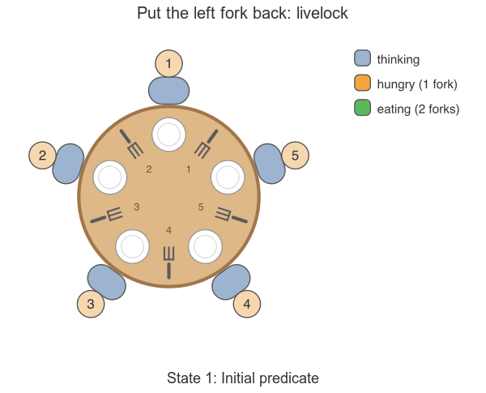

# Dining Philosophers

This folder contains two independent specifications of the
[Dining Philosophers problem](https://en.wikipedia.org/wiki/Dining_philosophers_problem).

## From naive to correct (TLA+)

[`DiningPhilosophers.tla`](DiningPhilosophers.tla) models the forks directly.

The git history shows how the spec got there. The table lists, for each
commit, the properties for which TLC finds a counterexample:

| Step | Solution | Known as | Coordination | Deadlock | Livelock | Starvation | Eating[^eating] | Spectacle |
|---|---|---|---|---|---|---|---|---|
| 1 | [Take the forks in any order](https://github.com/tlaplus/examples/commit/89da1aa3e41b33fdb00062fa0a0a57ef4494e211) | Unordered fork acquisition | none | yes | yes | yes | | [open](https://will62794.github.io/spectacle/#!/home?specpath=https%3A%2F%2Fraw.githubusercontent.com%2Ftlaplus%2Fexamples%2F89da1aa3e41b33fdb00062fa0a0a57ef4494e211%2Fspecifications%2FDiningPhilosophers%2FDiningPhilosophers.tla&constants%5BN%5D=5) |
| 2 | [Take the left fork before the right fork](https://github.com/tlaplus/examples/commit/bf33e1bb350d46fc55904002e5de3807466de573) | [Naive (symmetric) solution](https://en.wikipedia.org/wiki/Dining_philosophers_problem#Problems) | none | yes | yes | yes | | [open](https://will62794.github.io/spectacle/#!/home?specpath=https%3A%2F%2Fraw.githubusercontent.com%2Ftlaplus%2Fexamples%2Fbf33e1bb350d46fc55904002e5de3807466de573%2Fspecifications%2FDiningPhilosophers%2FDiningPhilosophers.tla&constants%5BN%5D=5) |
| 3 | [Put the left fork back if the right fork is taken](https://github.com/tlaplus/examples/commit/3f171e1ec2db66c4ffa87727e8ed1a74f40c46fa) | Back-off and retry | none | no | yes | yes | | [open](https://will62794.github.io/spectacle/#!/home?specpath=https%3A%2F%2Fraw.githubusercontent.com%2Ftlaplus%2Fexamples%2F3f171e1ec2db66c4ffa87727e8ed1a74f40c46fa%2Fspecifications%2FDiningPhilosophers%2FDiningPhilosophers.tla&constants%5BN%5D=5) |
| 4 | [Take both forks at once](https://github.com/tlaplus/examples/commit/de09177ff01f1c821ce17a0243286a27d605eba5) | [Dijkstra's semaphore solution (Tanenbaum's monitor)](https://en.wikipedia.org/wiki/Dining_philosophers_problem#Dijkstra's_solution) | atomic fork pair | no | no | yes | | [open](https://will62794.github.io/spectacle/#!/home?specpath=https%3A%2F%2Fraw.githubusercontent.com%2Ftlaplus%2Fexamples%2Fde09177ff01f1c821ce17a0243286a27d605eba5%2Fspecifications%2FDiningPhilosophers%2FDiningPhilosophers.tla&constants%5BN%5D=5) |
| 5 | [Let a philosopher who ate wait for its neighbors](https://github.com/tlaplus/examples/commit/173c60f8d1375217f61b901094b0dd36acd967c2) | [Priority to waiting neighbors](https://www.cs.utexas.edu/~EWD/transcriptions/EWD03xx/EWD310.html) | neighbors + atomic fork pair | no | no | no | —[^step5] | [open](https://will62794.github.io/spectacle/#!/home?specpath=https%3A%2F%2Fraw.githubusercontent.com%2Ftlaplus%2Fexamples%2F173c60f8d1375217f61b901094b0dd36acd967c2%2Fspecifications%2FDiningPhilosophers%2FDiningPhilosophers.tla&constants%5BN%5D=5) |
| 6 | [Let a waiter serve philosophers in order](https://github.com/tlaplus/examples/commit/637ef15fc210e5785bb3f9a68769392ca36601d3) | Waiter (arbitrator) with a queue | global queue | no | no | no | 0.73 | [open](https://will62794.github.io/spectacle/#!/home?specpath=https%3A%2F%2Fraw.githubusercontent.com%2Ftlaplus%2Fexamples%2F637ef15fc210e5785bb3f9a68769392ca36601d3%2Fspecifications%2FDiningPhilosophers%2FDiningPhilosophers.tla&constants%5BN%5D=5) |
| 7 | [Let a footman seat at most `N-1` philosophers](https://github.com/tlaplus/examples/commit/20efef8f7b1b790d3643284d7c96434453580581) | [Footman (butler) solution](https://en.wikipedia.org/wiki/Dining_philosophers_problem#Limiting_the_number_of_diners_in_the_table) | global counter | no | no | no | 0.42 | [open](https://will62794.github.io/spectacle/#!/home?specpath=https%3A%2F%2Fraw.githubusercontent.com%2Ftlaplus%2Fexamples%2F20efef8f7b1b790d3643284d7c96434453580581%2Fspecifications%2FDiningPhilosophers%2FDiningPhilosophers.tla&constants%5BN%5D=5) |
| 8 | [Let philosopher `N` take its right fork first](https://github.com/tlaplus/examples/commit/048764145a337a362be7bcb3140c158ed06d35f6) | [Resource hierarchy (asymmetric) solution](https://doi.org/10.1147/sj.72.0074) | fork order (local) | no | no | no | 0.55 | [open](https://will62794.github.io/spectacle/#!/home?specpath=https%3A%2F%2Fraw.githubusercontent.com%2Ftlaplus%2Fexamples%2F048764145a337a362be7bcb3140c158ed06d35f6%2Fspecifications%2FDiningPhilosophers%2FDiningPhilosophers.tla&constants%5BN%5D=5) |
| 9 | Let even philosophers take their right fork first | Odd/even (alternating) solution | fork order (local) | no | no | no | 0.72 |  |

This repository has specs of two other solutions:

- **Chandy-Misra:** philosophers hand clean forks to their neighbors on
  request. See [`DiningPhilosophersPCal.tla`](DiningPhilosophersPCal.tla)
  [below](#chandy-misra-pluscal).
- **Bakery:** hungry philosophers take a ticket, and the lowest ticket eats
  first. The ticket order gives a fair, first-come-first-served solution.
  Lamport's Bakery algorithm and its Boulangerie variant are in
  [`Bakery-Boulangerie`](../Bakery-Boulangerie). They solve mutual exclusion,
  not dining, but the ticket idea carries over.

TLC checks the spec only for `N = 5`.
[`DiningPhilosophers_proof.tla`](DiningPhilosophers_proof.tla) proves with
TLAPS that the spec is free of deadlock, livelock, and starvation for every `N`:

```
tlapm --strict DiningPhilosophers_proof.tla
```

[`DiningPhilosophers_anim.tla`](DiningPhilosophers_anim.tla) draws the table,
forks, and philosophers for any `N` and writes one SVG per state. The
animation comes from [Spectacle](https://github.com/will62794/spectacle).



[^eating]: Average number of philosophers eating per state, for `N = 5`. The
    spec does not model time, so states stand in for it. In each step, a
    random philosopher who can act takes one step. TLC's averages come close
    to the exact ones computed by [PRISM](https://www.prismmodelchecker.org).

[^step5]: Not measured. A meal takes three steps in the other solutions but
    two with priority to waiting neighbors, because philosophers get hungry
    without a step. More of its states are thus eating states, so its average
    is not comparable.

## Chandy-Misra (PlusCal)

[`DiningPhilosophersPCal.tla`](DiningPhilosophersPCal.tla) is a PlusCal
algorithm of the
[Chandy-Misra solution](https://en.wikipedia.org/wiki/Dining_philosophers_problem#Chandy/Misra_solution).
Unlike in Dijkstra's formulation, philosophers here talk to each other: they
hand clean forks to their neighbors on request. It is based on the exercise
at [learntla.com](https://learntla.com/temporal-logic/operators/).
[`APDiningPhilosophersPCal.tla`](APDiningPhilosophersPCal.tla) adds the type
annotations that Apalache needs.
